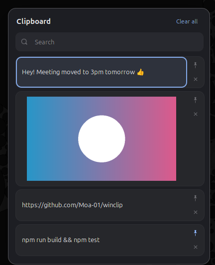

# WinClip

Clipboard history for GNOME that works like Windows' **Win + V**, with a cleaner look.

Press **Super + V** (the Windows key + V) and a small panel opens with everything you copied recently: text, links, screenshots and images. Click an item and it gets pasted into the app you were using.

<p align="center"></p>

## Features

- **Super + V** opens the history next to your mouse pointer.
- Keeps your **last 25 copies**, both text and images, with image previews. Pinned items come on top of that.
- **Click or press Enter to paste** into the app you were in. Terminals get Ctrl + Shift + V automatically.
- **Pin** items (📌) so they stay through **Clear all**, logouts and restarts.
- **Keyboard friendly:** ↑ / ↓ to move, Enter to paste, Delete to remove, Esc to close.
- **Click outside** to close it. Works across multiple monitors.
- Copying the same thing again moves it to the top instead of adding a duplicate.
- Skips copies that password managers mark as secret.
- Light on resources: nothing runs until you copy something or press Super + V.

## Requirements

- **GNOME Shell 46 to 50.** Tested on Ubuntu 24.04 with GNOME 46 on Wayland. 47 to 50 are allowed but untested (see [Limitations](#limitations)).
- Nothing else to install. It uses only what a GNOME desktop already ships (GNOME Shell, Python 3, Xwayland).

> Not for KDE Plasma (it has Klipper built in), Sway, Hyprland or other desktops. WinClip is a GNOME Shell extension.

Check your version with:

```bash
gnome-shell --version
```

## Install

```bash
git clone https://github.com/Moa-01/winclip.git
cd winclip
./install.sh
```

Then **log out and log back in**. On Wayland, GNOME only loads new extensions at login. A full restart isn't needed.

After that, copy something and press **Super + V**.

### What the installer does

1. Copies the extension to `~/.local/share/gnome-shell/extensions/winclip@local/`.
2. Compiles its settings schema (the keyboard shortcut).
3. Adds it to your enabled extensions, and turns on user extensions in general if they were switched off.
4. Frees up **Super + V**. GNOME normally opens the notification list with Super + V *and* Super + M, so the installer removes only Super + V and keeps your other shortcuts. It remembers what you had, and `uninstall.sh` puts it back exactly.

Everything is installed for your user only. No `sudo`.

### Update

```bash
cd winclip
git pull
./install.sh
```

Check which version you have with `gnome-extensions info winclip@local` (the `Version` line) or in the Extensions app. What changed in each version is in [CHANGELOG.md](CHANGELOG.md), and every version is on the [Releases page](https://github.com/Moa-01/winclip/releases).

Then log out and back in.

## Usage

| Action | How |
|---|---|
| Open / close history | **Super + V** |
| Paste an item | Click it, or select it and press **Enter** |
| Move between items | **↑ / ↓** |
| Remove an item | **Delete**, or the **✕** button |
| Pin / unpin | The **📌** button |
| Remove everything except pins | **Clear all** |
| Close without pasting | **Esc**, or click anywhere outside the panel |

### When items go away

Like Windows, unpinned history only lasts for your session:

| Event | What's removed |
|---|---|
| Log out / restart | All unpinned items |
| More than 25 unpinned items | The oldest unpinned item (pins don't count toward the 25) |
| **Clear all** | All unpinned items |
| **✕** on an item | That item, pinned or not |
| Locking the screen | Nothing. History is kept (WinClip stays on while the screen is locked; the popup just closes) |

Pinned items are saved to disk and come back after a restart.

### Change the shortcut

```bash
gsettings --schemadir ~/.local/share/gnome-shell/extensions/winclip@local/schemas \
  set org.gnome.shell.extensions.winclip toggle-history "['<Super><Shift>v']"
```

It usually applies right away. If it doesn't, log out and back in.

## How it works

WinClip is a GNOME Shell extension, a small piece of JavaScript that runs inside GNOME Shell itself (`extension.js`).

**Why an extension and not a normal app?** On Wayland, regular apps aren't allowed to read the clipboard in the background, which protects you from apps spying on your copies. GNOME doesn't offer the extra protocol that some other desktops use for clipboard managers. The only place that can see every copy on GNOME is the shell itself, so WinClip lives there.

1. **Watching copies.** WinClip listens for GNOME's "clipboard owner changed" signal. When you copy something it reads the content once:
   - **Text** (anything that offers plain text) is stored as text.
   - **Images** (PNG preferred, otherwise any image format) are stored as the raw image bytes when the copy has no text version. This covers screenshots and "Copy image" in browsers.
   - **Files copied in the Files app** are remembered as files. A single image file is shown as its picture; anything else is shown as its path. Pasting gives the *files* back, just like Ctrl + V, so they paste into the Files app and onto the desktop.
2. **History.** Items live in memory, newest first: 25 unpinned items plus your pins. Each one gets a fingerprint (an MD5 hash of the text or image) so repeat copies move to the top instead of piling up. Every copy is read in the background and the read stops at 4 MB, so an oversized copy is dropped without ever being loaded into GNOME Shell.
3. **The panel.** Super + V builds the panel with GNOME's own toolkit (St), places it near the pointer and takes keyboard focus. A transparent layer covers every monitor so a click outside closes it. When it closes, the whole panel is destroyed, so nothing stays around while it's hidden.
4. **Pasting.** Clicking an item puts it back on the clipboard. WinClip then waits a moment for focus to return to your app and presses **Ctrl + V** with a virtual keyboard. For terminals it presses **Ctrl + Shift + V**; a terminal is spotted by its window class name (`gnome-terminal`, `kitty`, `alacritty`, `wezterm`, `foot`, `konsole`, `tilix`, `ghostty`, `terminator`, `ptyxis`, …).
   - **Files** need several clipboard formats at once: the Files app and desktop read `x-special/gnome-copied-files`, while Slack, browsers and most other apps read `text/uri-list` (or the picture itself). GNOME 46 only lets an extension offer *one* format, so for file items WinClip starts `paste-helper.py`. This tiny helper takes the clipboard through X11 (an X11 app may do that without focus, and GNOME forwards every format to all apps) and offers all of them, like the Files app does. WinClip sends Ctrl + V once the helper says it's ready. The helper exits as soon as anything else is copied.
   - If the helper can't start or isn't ready within 1 second, WinClip pastes anyway with just the Files-app format, so the Files app and desktop still work. The helper also quits by itself if it can't get the clipboard within 5 seconds.
5. **Pins.** Pinned items are written to `~/.local/share/winclip/pinned.json`, with images stored as base64. They're saved in the background, readable only by you (file `0600`, folder `0700`). If that file is ever damaged, it's moved aside as `pinned.json.broken-<date>` instead of being overwritten. The only other file WinClip keeps is `toggle-message-tray.orig` in the same folder: the installer's note of your original notification shortcut.

### Memory and disk use

- **Per-item limit:** anything over **4 MB** is skipped (measured in bytes, so non-Latin text isn't let through at twice the size), the same limit Windows uses.
- **History limit:** **25 unpinned items** maximum, plus whatever you pin.
- **Image previews:** small thumbnails (at most 300 × 170 px), made once per image in the background and reused. Images over about 36 megapixels get no preview rather than being decoded.
- **Measured memory:** 25 full-screen screenshots in history added about 45 MB to GNOME Shell's memory, which is the worst case. A text-only history is a few kilobytes.
- **File paste helper:** about 11 MB (15 MB with a 4 MB image). It only runs while a file you pasted from WinClip is on the clipboard, at most one at a time, and exits on your next copy.
- **Disk:** the extension itself is about 50 KB. The only file it keeps is the pins file. Temporary files in `$XDG_RUNTIME_DIR/winclip/` (a RAM-backed folder only you can read) are deleted right away: the helper's handover files as soon as it reads them, and images being previewed as soon as their size is checked.

## Limitations

- **GNOME only.** No support for KDE, Sway, Hyprland, Xfce and so on.
- **Tested only on GNOME 46 / Ubuntu 24.04 / Wayland.** GNOME 47 to 50 are listed as supported so the extension loads there, but they haven't been tested. WinClip already adapts to the changes known so far (GNOME 48's new box-layout setting, the newer way of reaching the virtual keyboard). X11 sessions should work too, also untested. If it misbehaves on your version, please open an issue.
- **GNOME 51 and newer won't load it.** GNOME only loads extensions that list its version in `metadata.json`, because its internals change each release. Once a version is tested it can be added. Until then you can skip the check for *all* extensions, at your own risk: `gsettings set org.gnome.shell disable-extension-version-validation true`.
- **Log out after installing or updating.** Wayland can't reload GNOME Shell while you're logged in.
- **Opens near the mouse, not the text cursor.** Windows opens it at the text cursor, but Wayland doesn't tell extensions where that is.
- **One format per item.** Each copy is stored as plain text *or* an image. Formatting (bold, links in rich text, spreadsheet cells) is lost; pasting gives plain text. When a copy offers both text and an image (common in office apps), the text is kept.
- **Pasting files needs Xwayland** (GNOME runs it by default). Without it, files only paste into the Files app and the desktop. On systems that start Xwayland only when an app first needs it, the very first file paste may fall back to Files-app-only. Later pastes work fully.
- **Files are pasted from where they were.** If a file was moved or deleted since you copied it, pasting it does nothing.
- **Rich formats are only kept for files.** For text, only the plain text is restored (see *One format per item*).
- **Non-Latin keyboard layouts are untested.** Auto-paste presses the *V* key. With a layout that has no V (Arabic, Russian, Greek…) active, the automatic paste might not happen. The item is still on the clipboard, so Ctrl + V by hand works.
- **Auto-paste presses Ctrl + V** (or Ctrl + Shift + V in recognised terminals). Apps with a different paste shortcut, or terminals whose window class isn't in the list, won't paste automatically. The item is still on the clipboard, so paste it yourself.
- **Password safety depends on the password manager.** Copies are skipped only when the app marks them as secret (`x-kde-passwordManagerHint`, used by KeePassXC and others). Passwords from apps that don't do this stay in history until you log out, unless you remove them with ✕.
- **Pins are stored unencrypted** in `~/.local/share/winclip/pinned.json`. Don't pin secrets.
- **Dark theme only.**
- **Not included from Windows 11:** search, the emoji / GIF / symbol tabs, and cloud sync between devices.
- **Not on extensions.gnome.org.** Install it from this repo.

## Troubleshooting

**Super + V does nothing**

1. Make sure you logged out and back in after installing.
2. Check that it's running:
   ```bash
   gnome-extensions info winclip@local
   ```
   `State` should be `ACTIVE` (older GNOME versions show `ENABLED`). If it's `ERROR`, look at the logs:
   ```bash
   journalctl --user -b | grep -iE "winclip|JS ERROR"
   ```
3. Make sure nothing else uses Super + V:
   ```bash
   gsettings get org.gnome.shell.keybindings toggle-message-tray   # should be ['<Super>m']
   ```

**An item didn't paste**

The app probably uses a different paste shortcut. The item is already on the clipboard, so press that app's paste shortcut.

**My pinned items disappeared**

If the pins file was damaged, WinClip doesn't overwrite it. It's moved aside as `~/.local/share/winclip/pinned.json.broken-<date>` and a warning is logged, so nothing is lost.

**An image shows as the word "Image"**

Either it's huge (over about 36 megapixels, where a preview would need hundreds of MB to make) or GNOME can't decode that format. Pasting it still works.

## Uninstall

```bash
./uninstall.sh            # remove WinClip, restore your original notification shortcut
./uninstall.sh --purge    # same, and also delete your pinned items
```

Then log out and back in.

## Files

| File | Purpose |
|---|---|
| `extension.js` | All the logic: watching copies, history, panel, pasting |
| `stylesheet.css` | The look |
| `metadata.json` | Extension name, ID and supported GNOME versions |
| `schemas/` | The Super + V shortcut setting |
| `paste-helper.py` | Offers files in every clipboard format when pasting (Python + libX11, no extra packages) |
| `install.sh` / `uninstall.sh` | Set up / remove for the current user |

## Contributing

Bug reports and ideas are welcome as [issues](https://github.com/Moa-01/winclip/issues). Please include your GNOME version (`gnome-shell --version`) and distro. Code changes are welcome as pull requests; `main` is protected, so every change is reviewed before it's merged.

## License

[MIT](LICENSE)
